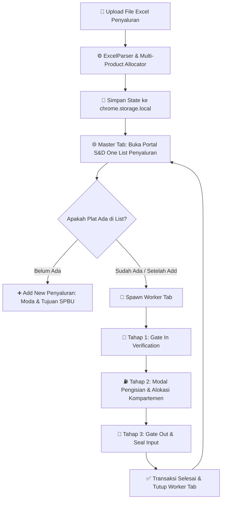

# ⛽ Pertamina S&D Autofill Assistant (Multi-Tab Edition)

[](https://developer.chrome.com/docs/extensions/mv3/intro/)
[](https://developer.mozilla.org/en-US/docs/Web/JavaScript)
[](https://github.com/Jooz404/Autofill_Program)
[](https://sndone.patraniaga.com/)

Sistem otomasi berbasis **Google Chrome Extension (Manifest V3)** untuk akselerasi penginputan data transaksi Penyaluran Mobil Tangki BBM pada portal operasional **S&D One (Supply & Distribution)** PT Pertamina Patra Niaga.

Dilengkapi dengan arsitektur **Master-Worker Multi-Tab Concurrency**, **Intelligent DOM Guardrails**, dan **Smart Excel Multi-Product Allocation Engine**.

---

## 🚀 Fitur Unggulan

- **⚡ Multi-Tab Parallel Processing (Master-Worker Architecture)**  
  Tab utama bertindak sebagai *Master Dispatcher* yang memindai list antrean mobil tangki dan membuka tab pekerja (*worker tabs*) secara simultan. State tab terisolasi penuh via `sessionStorage` untuk mencegah race condition.

- **🛡️ Intelligent Guardrail & Anti-Looping Modal**  
  Mekanisme validasi ketat pada modal pengisian produk: mencegah penambahan baris produk berlebih (`existingCount >= totalItems`), mendeteksi status pengisian eksisting, dan mencegah *double-click* melalui mutex locking (`_autofillLockUntil`).

- **📊 Smart Excel Parser & Aturan Vital Alokasi Multi-Produk**  
  Membaca file `.xlsx` dan memetakan nomor LO ke setiap kompartemen tangki dengan presisi 1-ke-1. Mematuhi aturan prioritas alokasi (misal: Pertalite Priority Rule untuk multi-produk subsidi).

- **🔄 Full Stepper Automation (End-to-End)**  
  Otomatisasi penuh alur Penyaluran:
  1. **Gate In**: Validasi plat nopol, waktu kedatangan, dan penugasan supir.
  2. **Pengisian**: Pengisian kompartemen, tangki, meter awal/akhir, dan volume KL.
  3. **Gate Out**: Pengecekan nomor segel, waktu keluar, dan finalisasi transaksi.

- **🎛️ Dynamic Side Panel Control Dashboard**  
  Antarmuka kontrol interaktif di panel samping Chrome: pemantauan log real-time, konfigurasi nomor tangki per produk, progress bar transaksi, serta kontrol darurat (Start / Pause / Reset).

---

## 🏗️ Alur Kerja Sistem (Workflow)



---

## 📁 Struktur Direktori Repository

```text
├── .agent/                             # AI Agent workflows & automation rules
│   └── workflows/
│       └── aturan_alokasi_multi_produk.md  # Aturan alokasi multi-produk & pemetaan LO
├── docs/                               # Dokumentasi teknis & arsip spesifikasi
│   ├── 01_Multi_Tab_Synchronization_Fix/   # Dokumentasi sinkronisasi multi-tab
│   ├── 02_Mode_Semi_Otomatis_Skip_Pengisian/ # Dokumentasi mode semi-otomatis
│   ├── 03_Network_Timeout_Recovery_Watchdog/ # Dokumentasi watchdog timeout jaringan
│   ├── 04_Max_Worker_Concurrency_Control/  # Dokumentasi kontrol konkurensi tab
│   ├── Dokumentasi_Perbaikan_MultiTab_dan_SemiOtomatis/
│   ├── DOKUMENTASI_PROJECT.html        # HTML render dokumentasi master
│   ├── PANDUAN_GIT_GITHUB.md           # Panduan version control Git & GitHub
│   └── Spesifikasi_Program_Autofill.docx # Dokumen spesifikasi program asli
├── .eslintrc.json                      # Konfigurasi ESLint (ES2022, Chrome Ext)
├── .gitignore                          # Aturan ignore (proteksi file Excel & dump)
├── background.js                       # Service worker Chrome Extension
├── content.js                          # Content script (DOM automation & page handlers)
├── DOKUMENTASI_PROJECT.md              # Master Architecture Blueprint & Contract
├── icon.svg                            # Asset ikon extension
├── manifest.json                       # Konfigurasi Chrome Extension Manifest V3
├── package.json                        # Definisi package & script linter
├── package-lock.json                   # Lockfile dependensi
├── popup.css                           # Styling antarmuka dashboard side panel
├── popup.html                          # Markup UI kontrol dashboard
├── popup.js                            # Logika controller dashboard & Excel parser
├── README.md                           # Dokumentasi utama repository ini
├── template_data_penyaluran.xlsx       # Template Excel contoh untuk pengujian
└── xlsx.full.min.js                    # Library SheetJS (Excel reader offline)
```

---

## 💻 Panduan Instalasi (Development Mode)

1. **Clone Repository**:
   ```bash
   git clone https://github.com/Jooz404/Autofill_Program.git
   cd Autofill_Program
   ```

2. **Muat Extension di Google Chrome**:
   - Buka browser Google Chrome dan navigasikan ke: `chrome://extensions/`
   - Aktifkan toggle **Developer mode** di pojok kanan atas.
   - Klik tombol **Load unpacked** (Muat yang belum dibongkar).
   - Pilih direktori root dari project ini (`Autofill_Program`).
   - Extension **Pertamina S&D Autofill Assistant (Multi-Tab)** siap digunakan!

3. **Verifikasi Kualitas Kode (Linting)**:
   ```bash
   npm install
   npm run lint
   ```

---

## 📑 Format Data Excel yang Didukung

Ekstensi membaca file Excel (`.xlsx`) dengan header kolom standar berikut (disediakan file contoh di [`template_data_penyaluran.xlsx`](file:///c:/Users/Josua/Downloads/Magang_Pertamina/Project%20Autofill%20RSD/template_data_penyaluran.xlsx)):

| Nama Kolom | Contoh Nilai | Keterangan |
| :--- | :--- | :--- |
| **Tanggal Shipment** | `2026-10-27 08:30:00` | Waktu Gate In mobil tangki |
| **No. Polisi** | `B 9123 SFV` | Nomor polisi kendaraan |
| **Supir aktual** | `NAMA SUPIR [73100001/1001]` | Nama pengemudi dan ID AMT |
| **Total volume[kL]** | `24` | Total volume angkut (KL) |
| **LO-KL** | `8140001001, 8140001002` | Daftar nomor LO Pertamina |
| **Produk** | `PERTALITE;BIOSOLAR B50;` | Jenis produk muatan |
| **Segel** | `SG1001, SG1002` | Nomor segel fisik |
| **Gate Out (State 80)** | `2026-10-27 10:15:00` | Estimasi waktu keluar |

---

## 📖 Dokumentasi Terkait

Untuk pemahaman mendalam tentang arsitektur dan aturan teknis, silakan pelajari dokumen berikut:
- **[DOKUMENTASI_PROJECT.md](file:///c:/Users/Josua/Downloads/Magang_Pertamina/Project%20Autofill%20RSD/DOKUMENTASI_PROJECT.md)**: Kontrak arsitektur utama & 5 Aturan Emas Pengembangan.
- **[aturan_alokasi_multi_produk.md](file:///c:/Users/Josua/Downloads/Magang_Pertamina/Project%20Autofill%20RSD/.agent/workflows/aturan_alokasi_multi_produk.md)**: Aturan vital pemetaan nomor LO dan alokasi produk bersubsidi.
- **[docs/](file:///c:/Users/Josua/Downloads/Magang_Pertamina/Project%20Autofill%20RSD/docs/)**: Kumpulan modul analisis teknis dan panduan pengujian.

---

## 🔒 Kebijakan Keamanan & Data Operasional

> [!IMPORTANT]
> - Seluruh file data Excel operasional (`*.xlsx`, `*.xls`, `*.csv`) dan temporary dump files secara otomatis diblokir oleh [`.gitignore`](file:///c:/Users/Josua/Downloads/Magang_Pertamina/Project%20Autofill%20RSD/.gitignore) untuk mencegah kebocoran data sensitif Pertamina Patra Niaga ke repository publik.
> - Hanya gunakan file [`template_data_penyaluran.xlsx`](file:///c:/Users/Josua/Downloads/Magang_Pertamina/Project%20Autofill%20RSD/template_data_penyaluran.xlsx) berisi data sintetis/dummy saat mendemonstrasikan aplikasi.
